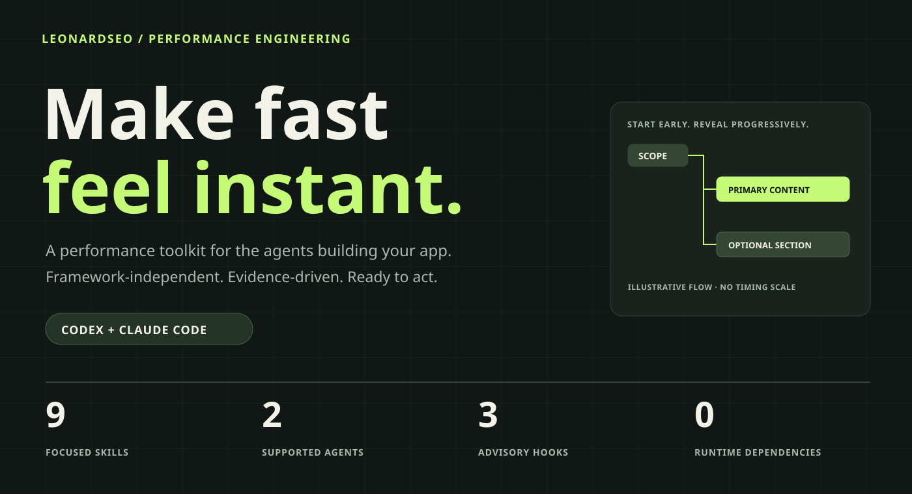
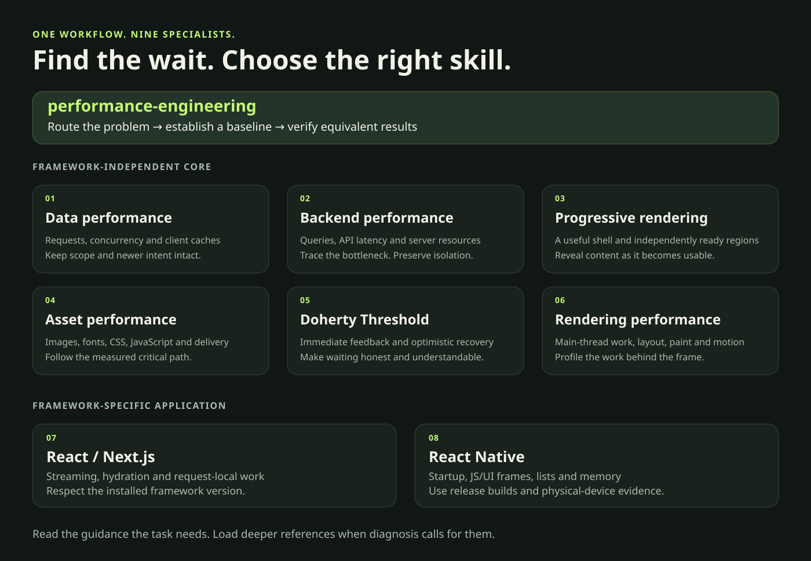
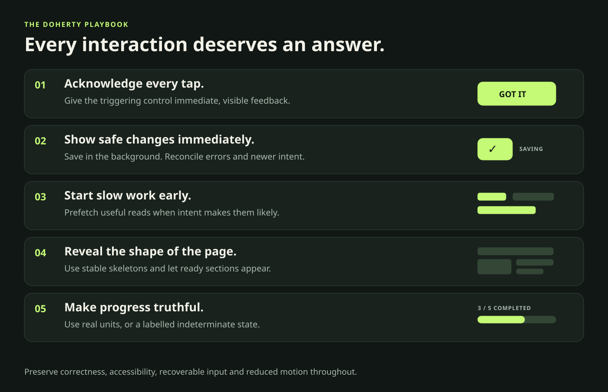

```bash
npx plugins add LeonardSEO/performance-engineering
```

[](https://github.com/LeonardSEO/performance-engineering/actions/workflows/checks.yml)
[](https://github.com/LeonardSEO/performance-engineering/releases/latest)
[](LICENSE)

**Give your coding agent a performance workflow—from the first request to the final frame.**

Performance Engineering brings nine focused skills to **Codex** and **Claude Code**. Find the bottleneck, choose the relevant guidance, preserve correctness, and verify the result. A framework-independent web/fullstack core covers data, backend work, page loading, assets, feedback and rendering. React/Next.js and React Native get dedicated specialists.

[Install](#install) · [Explore the skills](#nine-skills-one-workflow) · [See the evidence](#measured-and-reviewable) · [Get the release](https://github.com/LeonardSEO/performance-engineering/releases/latest)

## Build apps that respond

- **Useful content sooner.** Keep the page shell available and reveal independent sections as they become ready.
- **Feedback on every interaction.** Apply safe optimistic updates, recover from failures, and show truthful progress.
- **Less avoidable work.** Diagnose request waterfalls, N+1 queries, heavy resources and main-thread stalls.
- **Correctness throughout.** Preserve authorization, tenant boundaries, cache scope and write ordering.
- **Guidance when it matters.** Lightweight hooks suggest relevant skills without launching an audit or blocking a tool.

## Install

The command at the top detects supported agents. Choose one explicitly:

### Codex

```bash
npx plugins add LeonardSEO/performance-engineering --target codex
```

Open a new session, then use `/hooks` to review and trust the plugin's three hook definitions. Codex requires this normal trust review before hooks execute. Skills are also available for direct use.

### Claude Code

```bash
npx plugins add LeonardSEO/performance-engineering --target claude-code
```

Open a new session or use Claude Code's plugin reload flow.

<details>
<summary>Native marketplace installation</summary>

**Codex**

```bash
codex plugin marketplace add LeonardSEO/performance-engineering
codex plugin add performance-engineering@performance-engineering
```

**Claude Code**

```bash
claude plugin marketplace add LeonardSEO/performance-engineering
claude plugin install performance-engineering@performance-engineering
```

For local Claude development, use `claude --plugin-dir ./plugins/performance-engineering`.

</details>

**Requirements:** Node.js **22+** on the agent's execution PATH and a host version with plugin/command-hook support. Tested versions are listed in the [validation report](docs/validation-v0.2.0.md).

The installed plugin has **zero runtime package dependencies**. It needs no MCP server, API key or additional account. Use the browser, server and device tooling already available in your project; missing profilers lead to explicit verification steps and evidence limits.

## Nine skills. One workflow.



Start with `performance-engineering` for a broad problem. For a known bottleneck, go straight to its owner.

| Skill | Ask it to… |
|---|---|
| [performance-engineering](plugins/performance-engineering/skills/performance-engineering/SKILL.md) | Diagnose a slow journey, establish a baseline and organize comparable verification |
| [data-performance](plugins/performance-engineering/skills/data-performance/SKILL.md) | Remove request waterfalls, scope caches, bound concurrency and handle stale results |
| [backend-performance](plugins/performance-engineering/skills/backend-performance/SKILL.md) | Investigate API latency, N+1 queries, pools, query plans and server resources |
| [progressive-page-rendering](plugins/performance-engineering/skills/progressive-page-rendering/SKILL.md) | Reveal a useful shell and ready regions while preserving complete-record boundaries |
| [asset-performance](plugins/performance-engineering/skills/asset-performance/SKILL.md) | Improve critical image/font discovery, CSS/JS delivery, bundles and HTTP caching |
| [doherty-threshold](plugins/performance-engineering/skills/doherty-threshold/SKILL.md) | Acknowledge input, reconcile optimistic changes and make waiting understandable |
| [rendering-performance](plugins/performance-engineering/skills/rendering-performance/SKILL.md) | Profile main-thread work, layout, paint, lists and interruptible motion |
| [react-performance](plugins/performance-engineering/skills/react-performance/SKILL.md) | Apply version-aware React/Next.js streaming, hydration and render guidance |
| [react-native-performance](plugins/performance-engineering/skills/react-native-performance/SKILL.md) | Diagnose native startup, JS/UI frames, lists, memory and Hermes behavior |

Each domain owns its rules. Detailed references load when needed, and shared measurement guidance keeps the evidence consistent.

## Try it on a real problem

**Codex**

```text
Use $performance-engineering:performance-engineering to investigate this slow dashboard.
Find the dominant wait, preserve tenant isolation, and compare equivalent measurements.
```

**Claude Code**

```text
/performance-engineering:performance-engineering
Investigate this slow dashboard. Find the dominant wait, preserve tenant isolation,
and compare equivalent measurements.
```

More starting points:

- “Keep useful sections available while optional reports load.”
- “Make this toggle respond immediately and preserve the latest saved value when requests finish out of order.”
- “Find the actual LCP bottleneck and verify resource priorities.”
- “Profile this Next.js interaction before adding memoization.”
- “Investigate React Native startup using release-device evidence.”

## Make every interaction count



The commonly cited **400 ms** Doherty figure is a heuristic. The workflow distinguishes immediate acknowledgment, useful results, persisted completion and motion duration. Recovery, keyboard access and reduced motion belong to the same interaction design.

## Hooks that stay in scope

| Event | What you get |
|---|---|
| `SessionStart` | A short route guide and root-package stack detection |
| `UserPromptSubmit` | English/Dutch performance intent routes to at most two relevant skills |
| `PostToolUse` | Supported structured file changes can introduce a newly relevant domain |

The shared deterministic Node engine reads bounded project metadata and explicitly affected files. The nearest package determines the relevant stack; `.tsx` alone does not establish React Native. Unknown shell effects remain unknown.

Context is capped at **1,000 characters** at startup and **3,000 characters** per targeted suggestion. Domain suggestions are deduplicated per session and restored after compaction. Each hook has a **two-second timeout** and fails open.

Hooks do not run benchmarks, install packages, make network requests, execute project code or write into your project. Their local state contains bounded deduplication metadata; prompts and source code are not retained. See [execution, privacy and compatibility](docs/hooks.md).

To retain skills while silencing advisory output:

```bash
PERFORMANCE_ENGINEERING_HOOKS=off codex
# or
PERFORMANCE_ENGINEERING_HOOKS=off claude
```

PowerShell: set `$env:PERFORMANCE_ENGINEERING_HOOKS = "off"` before launch. Host plugin controls are also available.

## Measured and reviewable

| Evidence | Observed result |
|---|---|
| Hook-process benchmark | **83.15 ms p95** across **45** local macOS samples, including fresh Node startup |
| Deterministic tests | **19 tests**, passing on **Linux, macOS and Windows** with Node 22 |
| Installation | Universal, explicit Codex and explicit Claude routes verified against actual installed files |
| Native hosts | Both agents receive guidance after a real scratch-file write; Codex uses normal reviewed hook trust |
| Agent behavior | **24 historical paired reviews + 12 targeted v0.2.0 reviews** covering six scenarios in both agents |

The controlled local hook run met the 100 ms p95 target. Another local run reached 180.94 ms p95; [all observations are retained](validation/hook-benchmark-v0.2.0-history.json). Process startup and host conditions matter. Website and application speed gains require comparable measurements of the application itself.

Read the [full validation report](docs/validation-v0.2.0.md) and [sanitized agent responses](validation/agent-results.json) for methods, earlier diagnostic runs and residual model-output warnings. Baseline agents already handle many issues well. These results support the stated checks; they do not establish a universal percentage improvement or guarantee instruction following.

## Runnable examples and v0.2.0 improvements

The router now recognizes requests such as “Add lazy loading to images below the fold” and “Optimaliseer afbeeldingen voor mobiel”. New recipes cover hero/offscreen media, optional editors, ETag/304 revalidation, `scheduler.yield()` with a fallback, history restoration and durable mutation recovery.

| Controlled local reference case | Baseline median | Improved median |
|---|---:|---:|
| Primary-content DOM update | 661.40 ms | 109.60 ms |
| Encoded image response bytes | 320,535 bytes | 17,500 bytes |
| Double-frame feedback proxy | 141.40 ms | 64.00 ms |

These are **hand-authored synthetic reference variants**, with five trials each, rather than a causal estimate of installing the plugin. Both interaction variants complete 120 work units; scheduling prioritizes feedback and can lengthen total completion. The timing proxies are separate from LCP and field INP. See [conditions, raw trials and limits](validation/labs-v0.2.0.json).

```bash
npm ci
npm run labs:assets
npx playwright install chromium
npm run bench:labs -- --assert-budgets
```

The [labs](labs/README.md) also verify real conditional HTTP responses, concurrent/restarted writers, replay after a lost reply and actual bfcache restoration after a scope change. A manually dispatched browser CI workflow enforces configurable synthetic budgets; hooks never run it. Native context compaction has been exercised in both agents on macOS.

## Update or remove

Rerun the matching `npx plugins add` command to refresh a universal installation. Native installations use the host lifecycle:

```bash
# Codex
codex plugin marketplace upgrade performance-engineering
codex plugin add performance-engineering@performance-engineering
codex plugin remove performance-engineering@performance-engineering

# Claude Code
claude plugin update performance-engineering@performance-engineering
claude plugin disable performance-engineering@performance-engineering
claude plugin uninstall performance-engineering@performance-engineering
```

Codex also provides app controls for enabling/disabling plugins. Changed hook definitions can require renewed trust review. Inspect the host's plugin list before removing a registration made by another installer.

**Compatibility:** the tested Codex 0.163.0 runtime uses `.codex-plugin/plugin.json`; Claude uses `.claude-plugin/plugin.json`. Codex skips hooks for the portable root-manifest format on that version. The generated portable export manifest is therefore separate at `packaging/portable-plugin.json`. [Details](docs/hooks.md#tested-codex-format-limitation).

## Contribute a measured improvement

```bash
npm ci
npm run generate
npm run check
npm run bench:hooks
```

Identity and version metadata come from `plugin.meta.json`. Generation synchronizes native manifests, the portable export manifest, hook configurations and both marketplace catalogs. Explicit authenticated evaluations and native/installer smoke tests are documented in [validation](docs/validation-v0.2.0.md) and the [evaluation methodology](evals/README.md).

Bring a concrete journey, a reproducible fixture or a measured before/after result. Keep scope proportional, preserve the existing stack, and explain what the evidence establishes. The [SVG artwork](assets/README.md) is editable and available for sharing under the repository's MIT license.

If the workflow helps you ship a useful improvement, **star the repository and share the measured result**.

## License and acknowledgments

Published by **Leonard van Hemert**, free of charge under the [MIT license](LICENSE).

Built on public guidance from [Addy Osmani](https://github.com/addyosmani/web-quality-skills), [Vercel](https://github.com/vercel-labs/agent-skills), [Callstack](https://github.com/callstackincubator/agent-skills) and [Doherty Threshold](https://github.com/LeonardSEO/doherty-threshold). [Upstream licenses](licenses/) · [Pinned sources](docs/sources.lock.json).
